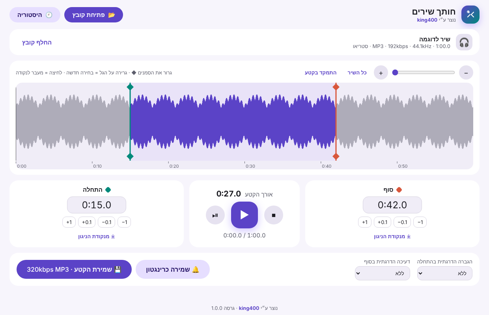
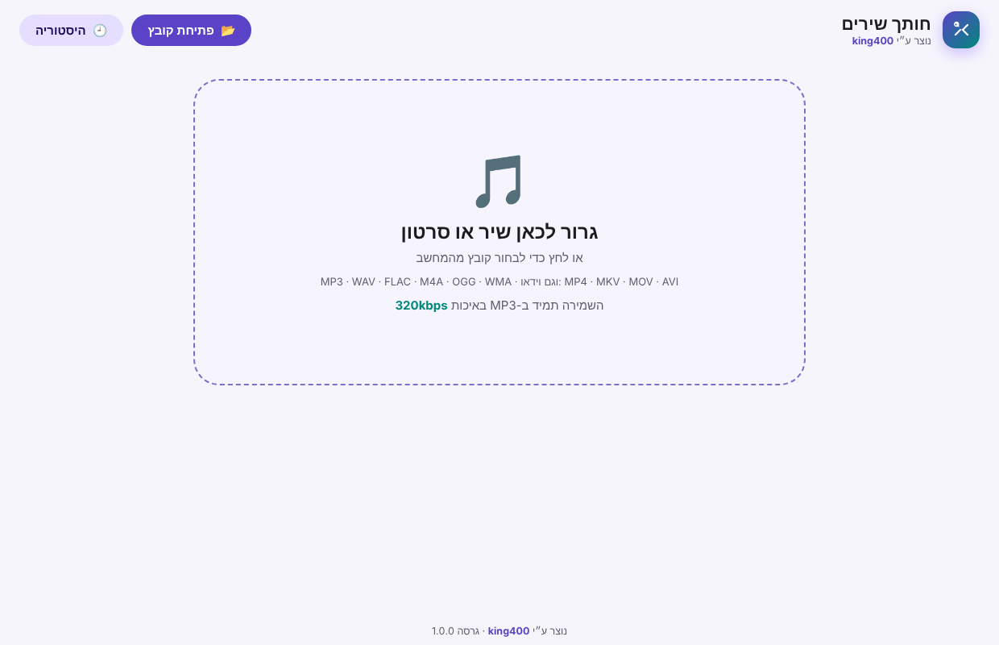
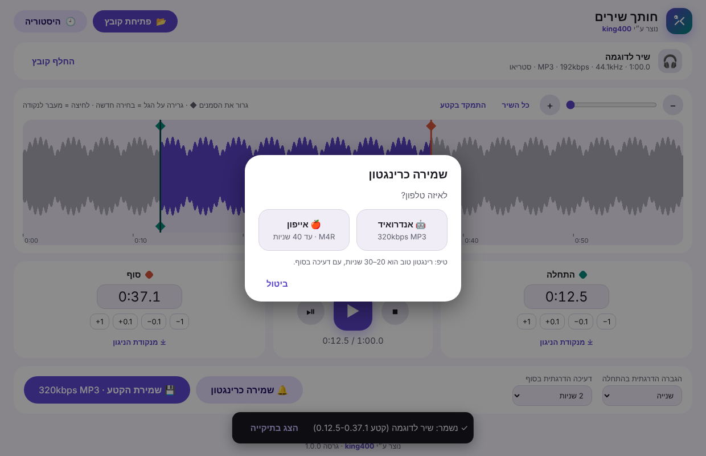
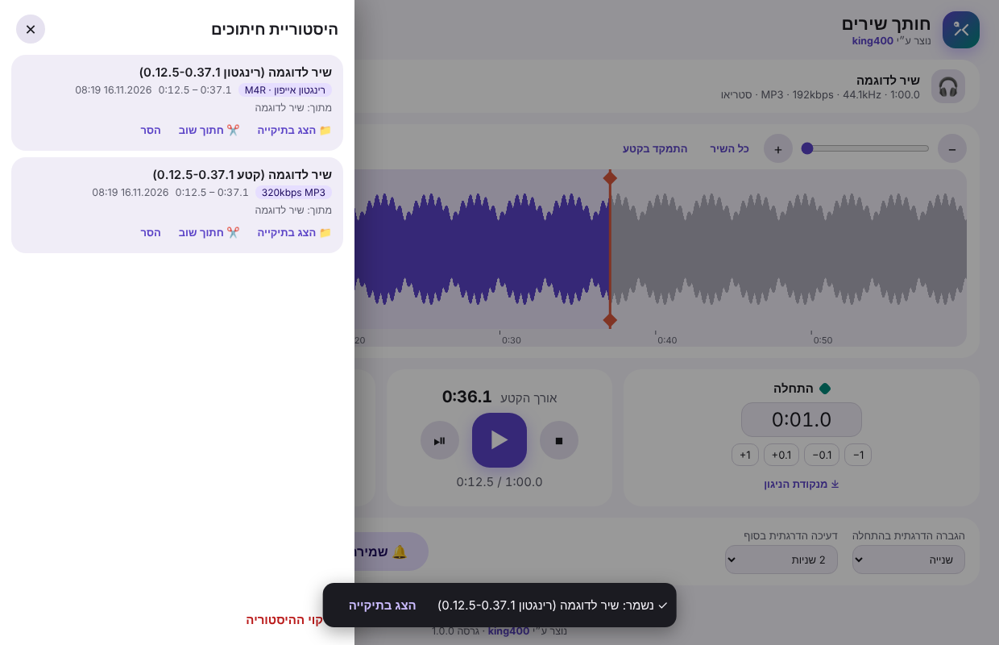
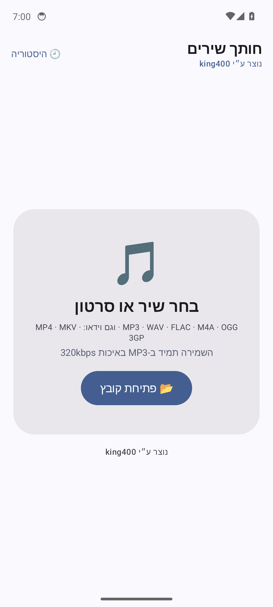
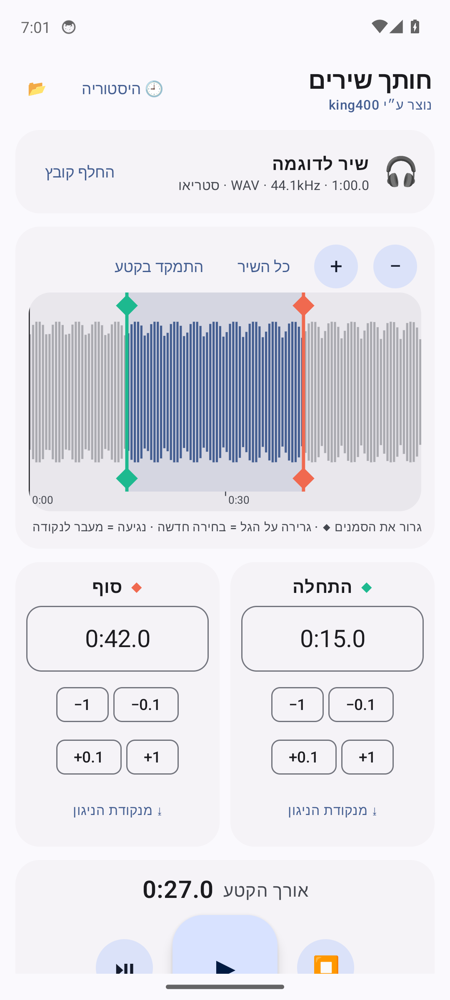
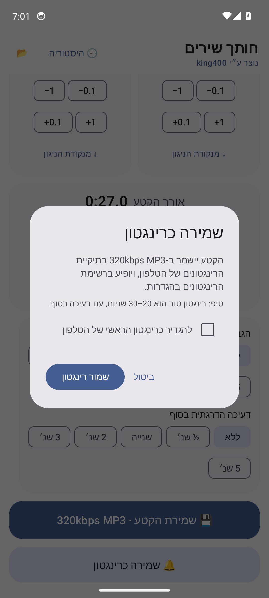

# ✂️ חותך שירים

**נוצר ע״י king400**

תוכנה למחשב (Windows) ואפליקציה לאנדרואיד לחיתוך שירים מכל קובץ שמע או וידאו. השמירה תמיד ב-**MP3 ‏320kbps**.

## מה אפשר לעשות
- **טעינת קבצים:** MP3, WAV, FLAC, M4A/AAC, OGG/Opus, WMA, וגם השמע מתוך סרטונים (MP4, MKV, MOV, AVI…). במחשב אפשר גם לגרור קובץ לחלון.
- **סימון הקטע:** גל קול עם שני סמנים לגרירה, זום, שדות זמן מדויקים וכפתורי ±0.1 / ±1 שנייה.
- **השמעה:** השמעה של הקטע לפני השמירה, כולל העמעום.
- **עמעום:** הגברה הדרגתית בהתחלה ודעיכה הדרגתית בסוף.
- **שמירה:** MP3 בקצב קבוע של 320kbps. התוכנה שואלת איפה לשמור.
- **רינגטון:**
  - **במחשב:** לאנדרואיד (MP3) או לאייפון (M4R, עד 40 שניות).
  - **בטלפון:** נשמר ישירות בתיקיית הרינגטונים, ואפשר להגדיר אותו כרינגטון הראשי.
- **היסטוריה:** כל מה שחתכת, עם אפשרות לפתוח את הקובץ, להשמיע, לשתף או לחתוך שוב את אותו קטע.

| מסך פתיחה | רינגטון | היסטוריה |
|---|---|---|
|  |  |  |

**באנדרואיד:**

| מסך פתיחה | עורך | רינגטון |
|---|---|---|
|  |  |  |

## התקנה
**Windows**
1. הורד את `SongCutter-Windows.zip` מדף ה-Releases.
2. חלץ את הקובץ לתיקייה כלשהי.
3. הפעל את `SongCutter.exe`.

**Android**
1. הורד את `SongCutter-Android.apk`.
2. פתח את הקובץ ואשר "התקנה ממקור לא ידוע".

## איך זה בנוי
| | מחשב | אנדרואיד |
|---|---|---|
| ממשק | Electron, עברית מימין לשמאל | Kotlin + Jetpack Compose, Material You |
| פענוח | ffmpeg (מצורף לתוכנה) | MediaExtractor + MediaCodec של אנדרואיד |
| קידוד MP3 | LAME דרך ffmpeg, ‏320kbps CBR | LAME (קוד מקור, נבנה עם NDK), ‏320kbps CBR |

שתי הגרסאות עובדות בלי אינטרנט. הקבצים לא יוצאים מהמכשיר.

## בדיקות
| מה | איך |
|---|---|
| לוגיקה (זמנים, סמנים, עמעום, שמות קבצים, היסטוריה) | `npm test` במחשב · `testDebugUnitTest` באנדרואיד |
| חיתוך אמיתי במחשב | `npm test`: בודק שהקובץ שנוצר הוא MP3 ב-320kbps ובאורך הנכון, את העמעום, M4R עד 40 שניות וביטול. רץ גם ב-Windows אמיתי ב-GitHub Actions |
| התוכנה המלאה במחשב | `npm run test:e2e` (Playwright): פתיחה, גרירת סמנים, השמעה, שמירה, רינגטון והיסטוריה |
| אנדרואיד במכשיר | בדיקות באמולטור (API 34): פענוח, חיתוך, MP3 ב-320kbps (כל פריים נבדק), עמעום, וממשק עם צילומי מסך |

## רישיונות
- **LAME:** ‏LGPL. קוד המקור נמצא ב-`android/app/src/main/cpp/lame`.
- **ffmpeg:** גרסת LGPL של BtbN, עם קובץ הרישיון בתיקיית `resources/bin`.
